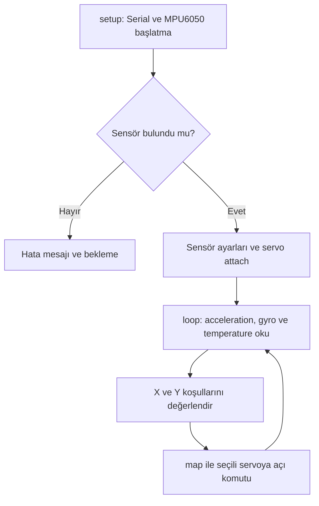

# Parachute Landing Concept — MPU6050 & Four-Servo Prototype

MPU6050 accelerometer ölçümlerini dört servo çıkışına dönüştüren Arduino/C++ prototipi. Paraşütlü bir elektronik kutunun iniş sırasında dengelenmesi hedefiyle ilişkili sensör–aktüatör kontrol mantığını içerir.

**Proje durumu:** Erken prototip. Bu depodaki kod, otonom ve kararlı iniş performansını tek başına doğrulamaz.

## Teknik kapsam ve işe alım açısından değeri

Mevcut kaynak; I2C üzerinden sensör entegrasyonu, sensör konfigürasyonu, koşul tabanlı actuator komutları ve Serial üzerinden temel hata ayıklama örneği sunar. Embedded Software ve mechatronics portföyünde, sensör verisinden fiziksel çıkış komutuna geçişi gösteren başlangıç çalışması olarak değerlendirilebilir.

PID, sensor fusion, roll/pitch hesabı, RTOS veya doğrulanmış flight-control deneyimi iddiası bu koddan çıkarılamaz. Projedeki kişisel katkı ve ekip sorumlulukları henüz belgelenmemiştir.

## Depo içeriği

| Dosya | İşlev |
| --- | --- |
| [gyro_code_full_mode.ino](gyro_code_full_mode.ino) | Sensör kurulumu, ölçüm okuma ve dört servo için koşul tabanlı komut üretimi |

İncelenen main ağacında başka dosya yoktur. README dışındaki modüller, testler, wiring diagram, CAD, fotoğraf, video, ölçüm logları ve dependency manifest henüz bulunmamaktadır.

## Mimari

Kod tek bir sketch içindedir; aşağıdakiler ayrı yazılım modülleri değil, mevcut işlevsel aşamalardır.

MPU6050 → Wire/I2C → Arduino sketch → Servo library → dört servo komut çıkışı. Gerçek servo mekanizması ve paraşüt bağlantısı depoda gösterilmemiştir.

## Kullanılan teknolojiler

| Teknoloji / bileşen | Kaynakta görülen kullanım |
| --- | --- |
| Arduino/C++ | setup() ve loop() tabanlı sketch |
| Adafruit_MPU6050 | MPU6050 başlatma, ayarlama ve getEvent() |
| Adafruit Unified Sensor | sensors_event_t veri yapıları |
| Wire | I2C kütüphanesi |
| Servo | Dört servo nesnesi; attach() ve write() |
| Serial | 115200 baud; durum, yön ve komut çıktıları |

Sensör ayarları: accelerometer ±8 g, gyro ±500 °/s, filter bandwidth 21 Hz. Bunlar sensör ayarlarıdır; kontrol döngüsünün 21 Hz çalıştığını göstermez.

Kesin controller board modeli, servo modeli, güç kaynağı, pin voltage seviyeleri ve library sürümleri belirtilmemiştir.

## Çalışma akışı

1. Serial başlatılır. MPU6050 bulunamazsa hata yazdırılır ve kod bekleme döngüsüne girer.
2. Sensör aralıkları ve filter bandwidth ayarlanır; 100 ms beklenir.
3. Servo 1–4 sırasıyla 7, 6, 5, 4 numaralı pinlere bağlanır ve her birine 0° komutu verilir.
4. loop() içinde acceleration, angular velocity ve temperature event verileri okunur.
5. Accelerometer X, Y ve Z değerleri int değişkenlere atanır; kesirli kısımlar kaybolur.
6. X ve Y için aşağıdaki koşullar kontrol edilir. Seçili servo komutu ve yön bilgisi Serial üzerinden yazdırılır.

| Çıkış | Pin | Koşul | Açı hesabı |
| --- | --- | --- | --- |
| servo1 | 7 | 0 < x < 10 ve -4 < y < 4 | map(x, 0, 10, 0, 180) |
| servo2 | 6 | -10 < x < 0 ve -4 < y < 4 | map(x, -10, 0, 180, 0) |
| servo3 | 5 | 0 < y < 10 ve -4 < x < 4 | map(y, 0, 10, 0, 180) |
| servo4 | 4 | -10 < y < 0 ve -4 < x < 4 | map(y, -10, 0, 180, 0) |

X ve Y tabloda int'e dönüştürülmüş acceleration değerleridir; açı değildir. Adafruit event acceleration birimi m/s²'dir. Z kaydedilir fakat karar mantığında kullanılmaz. Gyro ve temperature okunur fakat kontrol hesabına katılmaz.

X ve Y koşul grupları bağımsızdır; bir loop içinde iki servo güncellenebilir. Koşula girmeyen servo için yeni komut verilmez, önceki komut korunur.

## Kurulum ve bench gözlem akışı

Bu adımlar önerilen yeniden üretim yoludur; bu incelemede build veya hardware testi yapılmamıştır.

1. Arduino IDE ve kullanılacak board için gerekli board package kurulur. Board modeli önce gerçek donanımdan doğrulanmalıdır.
2. Adafruit MPU6050, Adafruit Unified Sensor ve IDE'nin istediği dependencies kurulur; Wire ve board ile uyumlu Servo library kullanılabilirliği kontrol edilir.
3. gyro_code_full_mode adlı sketch klasörü oluşturulup aynı adlı .ino dosyası içine yerleştirilir.
4. Sensörün SDA/SCL ve güç bağlantıları board ve breakout özelliklerine göre yapılır. Servo sinyal pinleri yukarıdaki tabloya göre bağlanır.
5. Servo beslemesi gerçek akım gereksinimine göre seçilir; controller ile common ground sağlanır. Depoda doğrulanmış bir güç şeması bulunmamaktadır.
6. Board ve port seçilip Verify/Upload yapılır. Serial Monitor 115200 baud açılır.
7. Mekanik yükten ayrılmış bench düzeneğinde sensör yönü değiştirilerek yön mesajları ve servo komutları gözlemlenir.

Örnek mantık kontrolü: int dönüşümü sonrasında x=5, y=0 ise servo1 için 90° komutu üretilir. Bu örnek kaynak kodun aritmetiğinden çıkarılmıştır; fiziksel denge veya iniş sonucu değildir.

## Görseller

**Mevcut:** Depoda fotoğraf, video, wiring diagram veya performans grafiği bulunmuyor. Yukarıdaki diagram yalnızca kod akışını temsil eder.

**Eklenmesi önerilen kanıtlar:**

| Görsel | Göstermesi gereken bilgi |
| --- | --- |
| Etiketli prototip fotoğrafı | Board, MPU6050 yönü, servo yerleşimi ve mekanik bağlantılar |
| Wiring diagram | Kesin board modeli, SDA/SCL, servo pinleri, güç hatları ve common ground |
| Bench demo videosu | Sensör hareketi, eşzamanlı Serial çıktısı ve servo tepkisi |
| İniş testi videosu | Kesintisiz test, bırakma koşulları ve iniş sonucu |
| Zaman serisi grafiği | Timestamp, ölçülen attitude/acceleration ve servo komutları |

Gerçek dosyalar eklenene kadar görsel linkleri ve başarı gösteren temsili fotoğraflar kullanılmamalıdır.

## Bilinen teknik sınırlar

- Mevcut algoritma acceleration thresholding ve linear mapping kullanır. Kalibre edilmiş bir attitude controller göstermez.
- Accelerometer verisi hareket ivmesini de içerir; dinamik inişte yalnızca bu değerlerden güvenilir tilt çıkarmak doğrulanmış değildir.
- float → int dönüşümü çözünürlüğü azaltır. Eşiklere tam eşit değerler strict comparison nedeniyle ilgili koşula girmez.
- Koşul dışındaki servolar nötre dönmez. Yön değişiminde önceki komut korunabilir.
- Servo mekanik limitleri, nötr konumları, montaj yönleri ve güvenli açı aralıkları belgelenmemiştir.
- Sabit loop periyodu, timestamp, watchdog, çalışma sırasında sensör kaybı yönetimi ve actuator feedback bulunmaz.
- Flight phase state machine, paraşüt açma tetiklemesi, altitude/vertical speed ölçümü ve touchdown detection bulunmaz.
- Stabilite, response time, descent rate ve landing accuracy için sonuç raporlanmamıştır.

## Eksik kanıtlar ve sonraki adımlar

| İddia / ihtiyaç | Şu anki kanıt | Tamamlanması gereken |
| --- | --- | --- |
| Sensörden servo komutuna veri akışı | Kaynak kodda mevcut | Doğrulanmış build ve bench kayıtları |
| Gerçek mekanik sistem entegrasyonu | Belgelenmemiş | BOM, wiring, fotoğraf ve montaj açıklaması |
| Otonom kararlı iniş | Doğrulanmamış | Tanımlı kabul kriterleri, tekrarlı iniş testleri ve loglar |
| Kontrol performansı | Ölçüm yok | Roll/pitch error, settling time ve servo saturation analizi |
| Yeniden üretilebilirlik | Eksik | Board/library sürümleri, pinout ve build talimatlarının test edilmesi |
| Kişisel mühendislik katkısı | Belgelenmemiş | Yazarın doğruladığı sorumluluk ve tasarım kararları |
| Test kapsamı | Test dosyası yok | Eşik, yön değişimi, sensör hatası ve mekanik limit senaryoları |

Öncelik: önce donanım ve mevcut davranışı tekrarlanabilir biçimde belgelemek; ardından gereksinimlere göre attitude estimation, kontrol ve fault handling tasarımını geliştirmek.

## Lisans

Depoda LICENSE dosyası bulunmuyor. Yeniden kullanım koşulları için proje sahibiyle iletişim kurulmalıdır.

## İnceleme referansı

- [Depo](https://github.com/eminozbaki/Electronic-box-with-parachute-capable-of-autonomous-stable-landing)
- İncelenen main commit: [0bbc2e4](https://github.com/eminozbaki/Electronic-box-with-parachute-capable-of-autonomous-stable-landing/commit/0bbc2e4f27da9c4fc668cde975b0720aecde7120), 17 Ocak 2024.
- Metadata updated_at: 24 Mayıs 2026 UTC; bu tarih kodun o tarihte değiştirildiğinin kanıtı değildir.
- İnceleme tarihi: 23 Ekim 2026. Statik kaynak incelemesi yapılmıştır; derleme ve fiziksel test yapılmamıştır.

